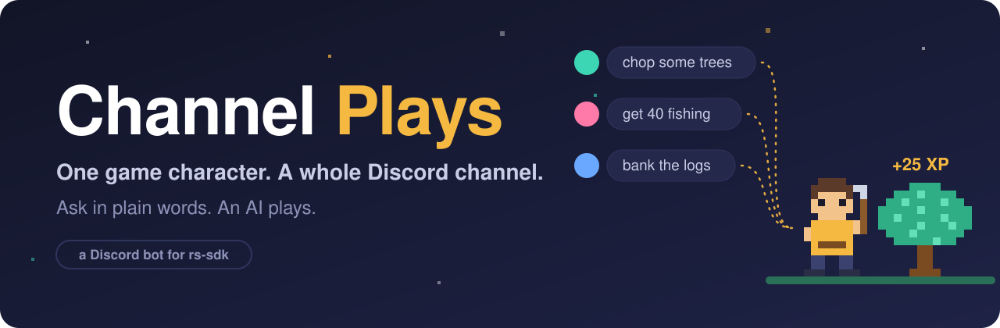
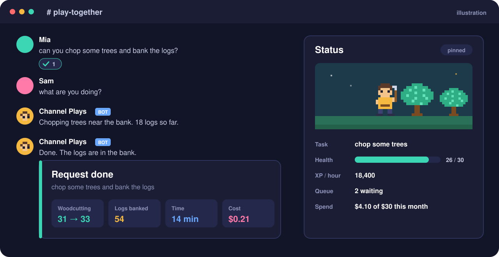

<p align="center">
  
</p>

<p align="center">
  <a href="https://github.com/Giftedx/rs-sdk-discord-bot/actions/workflows/ci.yml"></a>
  <a href="LICENSE"></a>
  
  
</p>

**Channel Plays is a Discord bot that lets a whole channel play one game character together.**

You ask in plain words, such as "get 40 fishing". An AI writes the code that plays the game, runs it, and posts how it went. Everyone in the channel watches the same character grow.

<p align="center">
  
  <br><sub>Illustration. The names and numbers are examples.</sub>
</p>

## Why it is fun

- **Everyone plays.** No game to install and no game account to make. Type a message, and the character acts.
- **Something to watch.** A pinned status card shows the game live. An adventure log records each level and haul. A drawn card marks each finished request, death and milestone, and a daily recap charts the XP.
- **It gets better.** The AI keeps its own scripts, notes and diary between restarts. It can search the game wiki.
- **It costs little.** The AI wakes only when something happens. Long tasks run as scripts with no AI in the loop. A monthly cap stops the spend.

## How it works

1. A small AI model reads each message and decides if it is for the bot.
2. A larger model writes game code for the request.
3. The code runs in a locked-down "box". The box holds no password and no API key.
4. A checker (the "proxy") sits between the box and the game. It passes only allowed actions, and it adds the game password itself.
5. The bot reads the game state and posts the results.

A thumbs-up on a waiting request moves it up the queue. "Stop that" ends the current request. There are no commands to learn.

The bot runs 24 hours a day on one small server. [docs/design.md](docs/design.md) has the full design.

The game is the RuneScape-style server of [rs-sdk](https://github.com/MaxBittker/rs-sdk), a research kit for game bots. Channel Plays is independent. It has no link to rs-sdk, its maintainer, or Jagex Ltd.

## Try it

The bot needs Linux. On Windows, use WSL2. The tests also run on Windows.

You need git and [Bun](https://bun.sh) 1.4.5. On Ubuntu, first install the Chrome libraries listed in [docs/development.md](docs/development.md).

```bash
git clone --recurse-submodules https://github.com/Giftedx/rs-sdk-discord-bot.git
cd rs-sdk-discord-bot
bun install
bun test
```

The tests end with `0 fail`.

- If `bun test` finds no browser, run `bunx puppeteer browsers install chrome` once.
- If Chromium says `No usable sandbox!`, read "Tests that launch Chromium" in [docs/development.md](docs/development.md). Do not add `--no-sandbox`.

Then pick your next step:

| To do this | Read |
|---|---|
| Run a game server on your own machine | [docs/development.md](docs/development.md) |
| Prepare an Ubuntu server | [docs/deploy-server.md](docs/deploy-server.md) |
| Install and run the bot | [docs/running-the-bot.md](docs/running-the-bot.md) |
| See CPU, RAM and bandwidth numbers | [docs/measurements.md](docs/measurements.md) |
| Know the risks before you deploy | [docs/security.md](docs/security.md) |
| See what is built and what has run live | [docs/roadmap.md](docs/roadmap.md) |

## Be a good guest on the demo world

By default, the bot connects to the rs-sdk demo world, `rs-sdk.maxbittker.com`. The rs-sdk maintainer runs it. The local commands in these documents never contact it.

- Ask the rs-sdk maintainer before you log a bot in. Say that an AI drives it.
- Permission that someone else got does not cover you.
- Use one account.
- Do not spam the game chat. The bot sends at most 6 chat messages per minute.
- Do not depend on the demo world. It has no guarantee of uptime or of saved progress.

The scripts refuse the demo world unless `RS_ALLOW_DEMO=1` is set. To use your own game server, set `RS_SERVER_HOST`, `RS_GATEWAY_URL` and `RS_BOT_PAGE_URL`.

## Security

This project does not claim to be secure. Do not run it on a machine that holds anything you care about.

- The AI's code never sees the game password, the Discord token or the API key.
- The checker blocks attacks and trades aimed at other players, chat commands, and every action while no job runs. It does not check what an allowed action does, so a bad request can still waste items.
- Jobs run as their own Unix user (`BOX_USER`), behind a firewall that lets them reach only the checker. The bot refuses to start without `BOX_USER`, unless you set `BOT_ALLOW_UNSANDBOXED=1` for local development.
- The browser always runs with its sandbox on.

[docs/security.md](docs/security.md) lists the known gaps. [SECURITY.md](SECURITY.md) says how to report a vulnerability.

## Contributing

Read [CONTRIBUTING.md](CONTRIBUTING.md). Run `bunx tsc --noEmit` and `bun test` before a pull request. Never commit a secret, edit `vendor/`, or add game art.

## Licence

MIT. See [LICENSE](LICENSE). rs-sdk (MIT) supplies the game server and the SDK. [THIRD_PARTY_NOTICES.md](THIRD_PARTY_NOTICES.md) has the details. The art in `docs/assets/` is original to this project.
